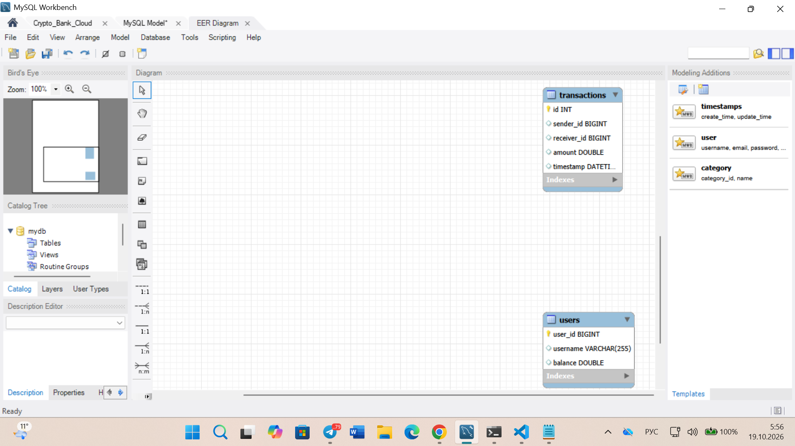

# 🐬 Crypto Bank Telegram Backend (MySQL + Systemd Cloud Deploy)

Профессиональный бэкенд-модуль автоматизированного финансового бота для Telegram со сквозной интеграцией с СУБД MySQL 8.0, встроенным парсингом рыночных котировок и фоновым развёртыванием на Linux-серверах (systemd).

## 🚀 Архитектура и ключевой функционал
* **Сетевой парсинг данных (Web Scraping):** Интеграция с REST API (CoinGecko) через библиотеку `requests` для получения live-котировок криптовалютного рынка (BTC, SOL) в реальном времени.
* **Промышленная СУБД (Enterprise DB):** Проектирование реляционной структуры таблиц (`users`, `transactions`) на сервере MySQL Workbench, оптимизация запросов и параметризованная защита от SQL-инъекций (`%s`).
* **Многопоточный транзакционный модуль:** Валидация балансов пользователей, предотвращение овердрафта (отрицательного баланса) и блокировка переводов «самому себе».
* **Автоматическая финансовая отчетность:** Генерация двухуровневых выписок и аналитических отчетов в формате CSV/Excel с защитой кодировок UTF-8 (`utf8mb4`).
* **Облачный Деплой (DevOps):** Код полностью адаптирован под требования 12-факторного приложения (12-Factor App) — все пароли и конфигурации вынесены в переменные окружения `os.getenv`. Развернут в фоновом режиме в облаке через системного демона Linux `systemd`.
* **Интегрированный Data Science модуль (Pandas + SQLAlchemy):** Сквозной импорт транзакционных логов из удаленной СУБД MySQL напрямую в аналитические матрицы Pandas DataFrame. Расчет математического ожидания (среднего чека) и волатильности (выборочного стандартного отклонения $\sigma$) финансовых потоков в реальном времени.

## 📊 Схема связей базы данных (EER-Diagram)


## 🛠️ Стек технологий
* **Language:** Python 3.12+
* **Framework:** pyTelegramBotAPI
* **Database СУБД:** MySQL Server 8.0 / pymysql (DictCursor)
* **DevOps / OS:** Linux Ubuntu, SSH, SOCKS5 Tunneling, systemd daemon

## 🔌 Быстрый запуск в облаке
1. Склонируйте репозиторий и активируйте виртуальное окружение:
```bash
python3 -m venv venv && source venv/bin/activate
pip install -r requirements.txt
```
2. Передайте пароль от СУБД и запустите бота одной командой:
```bash
MYSQL_PASSWORD="your_server_password" python3 tg_bot.py
```
